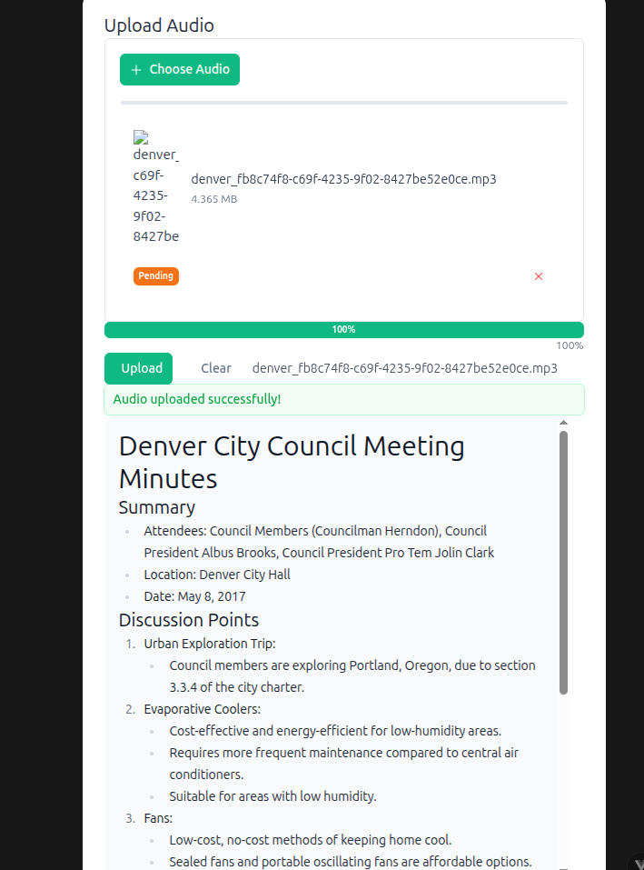
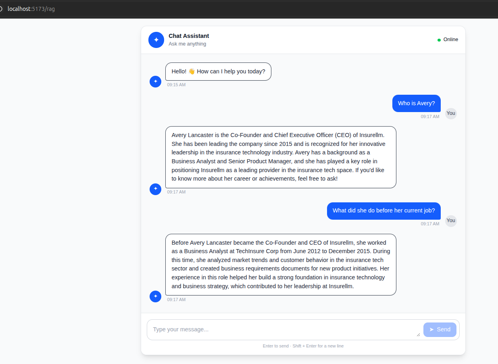

This is my first LLM AI Assistant app. My main goal for this very simple project is to get familiar with how LLm is working and how I can use tools and RAG in LLm to customize the frontier llm models for my own business app. 
These are the main used technologies:
1. OpenAI aapi
2. vue3 for the frontend
3. fastapi for the backend
4. docker, docker compose, postgres vector database

# How to run the app
```bash
cd api
docker compose up
```

For each new feature that I am learning about llm, I created a route for it in my vue frontend app:
- http://localhost:5173/
this page is using tools with LLM

- http://localhost:5173/meeting-minutes
this page is for  added another feature which is Creating meeting minutes from an Audio file. what it does is user upload a mp3 file and then, the new api endpoint (/audio/upload) will first transcribe the audio file uisng the model "openai/whisper-small.en" and then, it will summarize the transcript uisng the model "Qwen/Qwen2.5-0.5B-Instruct". 

I downloaded some Denver City Council meeting minutes and selected a portion of the meeting for us to transcribe. I downloaded it here:  
https://drive.google.com/file/d/1N_kpSojRR5RYzupz6nqM8hMSoEF_R7pU/view?usp=sharing

original data: the HuggingFace dataset is [here](https://huggingface.co/datasets/huuuyeah/meetingbank) and the audio can be downloaded [here](https://huggingface.co/datasets/huuuyeah/MeetingBank_Audio/tree/main).
I learned how to use pipeline from Hugging Face Transformers for the open source models. 




- http://localhost:5173/rag
I generated some fake data about a fake company and put all of it in a directory called "knowledge-base" so after you started the app, you need to run the following command in order to populate the postgres vector database with relevant vectorized data about the company.
```bash
cd api
uv run python -m app.rag.ingest
```
Here in this route, I started experimenting RAG. How we should vectorized our custom data using chunking technique and store it in the vector database (the command above); how we can vectorize the user question and then retrive the relevant context to the question and add them to the pser prompt to get a correct, complete and relevant answer.

