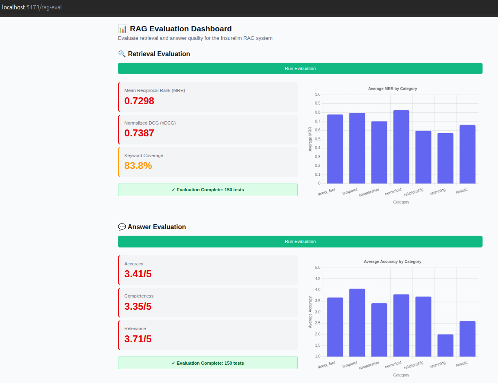
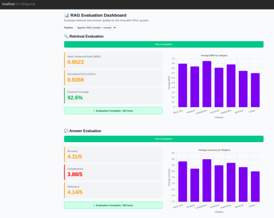

# LLM AI Assistant — Full-Stack Application

This is my first full-stack LLM AI Assistant application. The main goal of this project is to learn how Large Language Models (LLMs) work and how to use tools, Retrieval-Augmented Generation (RAG), open-source models, and evaluation techniques to customize LLM-powered applications for real-world business use cases.

The application provides a simple environment for experimenting with different LLM features, comparing paid and free models, processing audio files, retrieving information from custom knowledge bases, and evaluating the quality of RAG responses.

## Technologies Used

- **LLMs:** OpenAI API and open-source models running locally with Ollama
- **Embeddings:** OpenAI Embeddings and Hugging Face Sentence Transformers
- **Frontend:** Vue 3
- **Backend:** FastAPI
- **LLM Frameworks:** LangChain (simple RAG) and LiteLLM (agentic RAG, no LangChain)
- **Open-Source Models:** Qwen2.5 and Whisper
- **Vector Database:** PostgreSQL with pgvector
- **Containerization:** Docker and Docker Compose
- **Model Development:** Hugging Face Transformers

## Getting Started

### 1. Start the Application

Clone the repository, navigate to the API directory, and start the application using Docker Compose:

```bash
cd api
docker compose up
```

The Vue frontend is available at:

http://localhost:5173/

### 2. Choose Between Paid and Free Models

The application supports two model configurations. Switch between them using the `USE_PAID_MODELS` environment variable.

**Paid models — OpenAI**

```env
USE_PAID_MODELS=true
OPENAI_API_KEY=your_openai_api_key
```

This configuration uses:

- **Chat model:** `gpt-5.4-nano`
- **Embedding model:** `text-embedding-3-large`
- **Concurrency:** Up to 8 evaluation tests at a time

**Free models — Ollama and Hugging Face**

```env
USE_PAID_MODELS=false
```

This configuration uses:

- **Chat model:** `qwen2.5:7b`, running locally through Ollama
- **Embedding model:** `sentence-transformers/all-MiniLM-L6-v2`
- **Concurrency:** Up to 2 evaluation tests at a time to limit resource usage on a CPU-only machine

#### Install and configure Ollama

To use the free configuration, install [Ollama](https://ollama.com/) on your host machine and download the required model:

```bash
ollama pull qwen2.5:7b
```

Make sure the Ollama service is running:

```bash
sudo systemctl status ollama
```

By default, Ollama may listen only on the loopback interface (`127.0.0.1`). A Docker container cannot use its own `localhost` to reach a service running on the host machine. Therefore, Ollama must be configured to listen on an address that the container can reach.

**Step 1: Configure the Ollama systemd service**

Open the Ollama service configuration:

```bash
sudo systemctl edit ollama
```

Add the following override:

```ini
[Service]
Environment="OLLAMA_HOST=0.0.0.0:11434"
```

Save and close the editor.

This setting tells Ollama to listen on all network interfaces on port `11434`, rather than only on the host's loopback interface.

**Step 2: Reload systemd and restart Ollama**

```bash
sudo systemctl daemon-reload
sudo systemctl restart ollama
```

Verify that the service is running:

```bash
sudo systemctl status ollama
```

You can also verify that Ollama is responding on the host:

```bash
curl http://localhost:11434/api/tags
```

**Step 3: Configure the FastAPI container to reach the host**

The FastAPI container must use a host-reachable address as its Ollama base URL. For example, on a typical Linux Docker Compose setup, you can configure the service as follows:

```yaml
services:
  api:
    extra_hosts:
      - "host.docker.internal:host-gateway"
    environment:
      OLLAMA_BASE_URL: "http://host.docker.internal:11434"
```

Replace `api` with your actual FastAPI service name if it differs.

Ensure your application settings read `OLLAMA_BASE_URL` into `settings.ollama_base_url`, which is used by the model configuration.

The exact configuration can vary depending on your Docker networking setup.

**Important security note:** `0.0.0.0` makes Ollama listen on all available network interfaces. Restrict access to port `11434` with your firewall so that only trusted systems can connect. Do not expose the Ollama API directly to the public internet.

The embedding model `sentence-transformers/all-MiniLM-L6-v2` is downloaded during the Docker image build, so it can be loaded locally without calling a paid embedding API.

The application uses separate PostgreSQL tables for the two embedding configurations:

- `documents` — OpenAI embeddings
- `documents_free` — Hugging Face embeddings

This separation is necessary because the two embedding models produce different vector representations. Documents must be ingested using the same embedding configuration that will be used to retrieve them.

The model configuration is centralized in the application's model profile, which selects the appropriate embedding model, chat model, evaluation judge, database table, and concurrency limit.

## Features

### 1. LLM Tools

**Frontend route:** [http://localhost:5173/](http://localhost:5173/)

This page is for experimenting with tools and LLM interactions. It provides a starting point for learning how LLMs can use external functionality to perform tasks beyond generating text.

### 2. Meeting Minutes from Audio

**Frontend route:** [http://localhost:5173/meeting-minutes](http://localhost:5173/meeting-minutes)

This feature generates meeting minutes from an uploaded MP3 audio file.

The processing pipeline consists of two steps:

1. **Audio transcription:** The API endpoint `/audio/upload` uses the `openai/whisper-small.en` model to convert speech into text.
2. **Meeting summarization:** The application uses `Qwen/Qwen2.5-0.5B-Instruct` to summarize the transcript and generate meeting minutes.

This feature helped me learn how to use Hugging Face Transformers pipelines with open-source models for audio transcription and text summarization.

For experimentation, I downloaded a portion of a Denver City Council meeting recording and used it to test the transcription and summarization pipeline.

**Sample audio:** [Denver City Council meeting excerpt](https://drive.google.com/file/d/1N_kpSojRR5RYzupz6nqM8hMSoEF_R7pU/view?usp=sharing)

**Original dataset:** [MeetingBank dataset on Hugging Face](https://huggingface.co/datasets/huuuyeah/meetingbank)

**Audio dataset:** [MeetingBank Audio on Hugging Face](https://huggingface.co/datasets/huuuyeah/MeetingBank_Audio/tree/main)

### 3. Retrieval-Augmented Generation (RAG)

**Frontend route:** [http://localhost:5173/rag](http://localhost:5173/rag)

This feature explores how RAG can improve LLM responses by grounding them in custom business data.

I generated synthetic data for a fictional company and stored the source documents in the `knowledge-base` directory.

Before using the RAG feature, populate the PostgreSQL vector database with the relevant documents:

```bash
cd api
uv run python -m app.rag.ingest --models free
```

The ingestion process prepares the documents, splits them into chunks, generates embeddings, and stores the resulting vectors in PostgreSQL using pgvector.

When a user submits a question, the application:

1. Converts the question into a vector using the configured embedding model.
2. Retrieves relevant document chunks from the vector database.
3. Adds the retrieved context to the LLM prompt.
4. Generates an answer grounded in the retrieved information.

This feature demonstrates how chunking strategies, embedding models, vector search, and prompt construction affect the accuracy, completeness, and relevance of generated answers.

**Important:** Run ingestion with the same embedding configuration used for retrieval. If you switch between paid and free models, populate the corresponding vector database table before evaluating or querying that configuration.

### 4. Agentic RAG (LLM Chunking, Query Rewriting and Reranking)

**Frontend route:** [http://localhost:5173/agentic-rag](http://localhost:5173/agentic-rag)

**API endpoint:** `POST /agentic-rag-messages?paid=false` (`?paid=true` for OpenAI, omit it to use `USE_PAID_MODELS`)

This is an improved version of the simple RAG pipeline above. It does not use LangChain: the LLM calls go through [LiteLLM](https://docs.litellm.ai/) (`app/services/llm_provider.py`) and the vector search is a plain pgvector SQL query (`app/services/agentic_rag_service.py`). The paid or free model can be chosen per request.

The improvements happen in two places.

**1. At ingestion — LLM chunking**

Instead of cutting each document into fixed 1000-character pieces, an LLM splits every document into meaningful chunks and gives each one a headline and a short summary, for example:

```text
Maxine Thompson - Career Progression (2/2)

This chunk continues Maxine's career progression from January 2021 to the present ...
```

Because the headline carries information that a fixed-size chunk would lose (such as the person's full name), retrieval finds the right chunk much more often.

```bash
cd api
uv run python -m app.rag.ingest-no-langchain --models free              # LLM chunking (slow)
uv run python -m app.rag.ingest-no-langchain --models free --chunking simple   # fixed-size chunks (fast)
```

**Note:** Ingestion replaces the contents of the table (`documents_free` or `documents`), so both RAG pipelines then search the newly ingested chunks.

**2. At query time — query rewriting and reranking**

When a user submits a question, the application:

1. **Rewrites the question** with the LLM, using the conversation history to resolve references. For example, *"What is her current role?"* becomes *"What is Maxine Thompson's current role?"*.
2. **Retrieves 20 chunks** for the original question and 20 chunks for the rewritten question, then merges them and removes duplicates.
3. **Reranks the chunks** with the LLM, which orders them by relevance to the question.
4. **Answers the question** using the top 10 reranked chunks as context and the same system prompt as the simple RAG.

When using Ollama, the rerank and answer steps run with a context window (`num_ctx`) of 8192 tokens. With a smaller window, Ollama silently cuts off the start of a long prompt (the instructions and the retrieved context).

### 5. RAG Evaluation

**Frontend route:** [http://localhost:5173/rag-eval](http://localhost:5173/rag-eval)

This feature evaluates the quality of the RAG implementation by running a curated test dataset against the RAG endpoint and measuring retrieval and answer quality.

Instead of relying only on manual testing, I created a test set containing questions and their expected answers. The evaluation pipeline uses an LLM-as-a-judge approach to compare generated responses with the expected answers.

The dashboard provides two groups of evaluation metrics.

#### Retrieval Evaluation

Retrieval evaluation measures whether the RAG system retrieves relevant information for a given question.

- **Mean Reciprocal Rank (MRR):** Measures how highly the first relevant result is ranked. Higher values indicate that relevant results tend to appear near the top.
- **Normalized Discounted Cumulative Gain (nDCG):** Measures the quality of the ranking while accounting for the relevance of retrieved results and their positions.
- **Keyword Coverage:** Measures how much of the expected keyword set is covered by the retrieved information.

The dashboard also displays average MRR by question category, helping identify which types of questions the retrieval system handles well and which need improvement.

#### Answer Evaluation

Answer evaluation measures the quality of the generated answers against the expected answers.

- **Accuracy:** Measures how factually correct the generated answer is.
- **Completeness:** Measures whether the answer covers the important information required to answer the question.
- **Relevance:** Measures how well the answer addresses the user's question.

An LLM judge grades the generated answers using the evaluation criteria. The dashboard displays average scores and breaks them down by question category to help identify weaknesses in the system.

A **Pipeline** selector at the top of the dashboard chooses which RAG implementation to evaluate. The API takes the same option as a query parameter:

```bash
curl -X POST "http://localhost:8000/rag-eval/retrieval?pipeline=agentic&paid=false"
curl -X POST "http://localhost:8000/rag-eval/answer?pipeline=agentic&paid=false&limit=10"
```

- `pipeline=simple` (default): the LangChain RAG from section 3
- `pipeline=agentic`: the agentic RAG from section 4

#### Evaluation Results

Both runs below used the free configuration and the full set of 150 tests.

**Run 1: Simple RAG**

- Chunking: fixed-size chunks of 1000 characters
- Retrieval: top 5 chunks by vector similarity
- Chat model and judge: `qwen2.5:3b` (`num_ctx` 4096)



**Run 2: Agentic RAG**

- Chunking: LLM chunking with a headline and summary for each chunk
- Retrieval: query rewriting, 2 × 20 chunks, LLM reranking, top 10 chunks
- Chat model and judge: `qwen2.5:7b` (`num_ctx` 8192 for answering and reranking)



**Comparison**

| Metric | Simple RAG | Agentic RAG | Change |
|---|---|---|---|
| Mean Reciprocal Rank (MRR) | 0.7298 | **0.8523** | +0.12 |
| Normalized DCG (nDCG) | 0.7387 | **0.8359** | +0.10 |
| Keyword Coverage | 83.8% | **92.6%** | +8.8 points |
| Accuracy | 3.41/5 | **4.11/5** | +0.70 |
| Completeness | 3.35/5 | **3.88/5** | +0.53 |
| Relevance | 3.71/5 | **4.14/5** | +0.43 |

Every metric improved. A few observations:

- **LLM chunking made the biggest difference.** The two runs differ in chunking, in the query-time steps, and in the model. Of these, the better chunks contributed most of the improvement in keyword coverage and answer quality.
- **Reranking mainly improves ranking.** Query rewriting and reranking raised MRR and nDCG further, because the most relevant chunk moves to the top. Keyword coverage barely changed, because 10 LLM-made chunks already contained most keywords.
- **Query rewriting has little effect in this evaluation.** Each test question is asked without conversation history, so there are no references (like "her" or "it") to resolve. Rewriting matters more in a real multi-turn chat.
- **The answer scores are not a strict comparison.** The judge model also changed from `qwen2.5:3b` to `qwen2.5:7b`, and a small local model is a noisy judge. Differences of about ±0.1 are within the normal variation between runs.

The dashboard makes it easier to identify areas for improvement, compare model configurations, and evaluate the impact of changes to the retrieval pipeline.

For example, lower retrieval scores in a particular category may indicate that the document chunking, embeddings, or retrieval strategy needs improvement. Lower answer scores may indicate that the retrieved context or prompt construction needs further work.

The goal is to use these metrics to guide iterative improvements to the RAG pipeline rather than relying exclusively on subjective assessments of individual responses.

## Project Goals and What I Learned

Through this project, I have been exploring:

- How to integrate LLMs into a full-stack application.
- How to use tools and extend LLM capabilities.
- How to run open-source models locally with Ollama and Hugging Face.
- How to switch between paid API-based models and locally hosted models.
- How to configure a host-based Ollama service for access from a Dockerized application.
- How to generate embeddings and store them in a PostgreSQL vector database.
- How to implement RAG using document chunking, vector retrieval, and prompt construction.
- How to improve RAG with LLM chunking, query rewriting, and LLM reranking.
- How to call paid and local models through one interface with LiteLLM.
- How to process audio files using speech-to-text models and generate meeting summaries.
- How to evaluate retrieval quality using MRR, nDCG, and keyword coverage.
- How to evaluate answer accuracy, completeness, and relevance using an LLM judge.
- How to use evaluation results to identify weaknesses and improve an LLM application.

This project is an ongoing learning exercise focused on understanding the practical components of building, testing, and improving LLM-powered business applications.